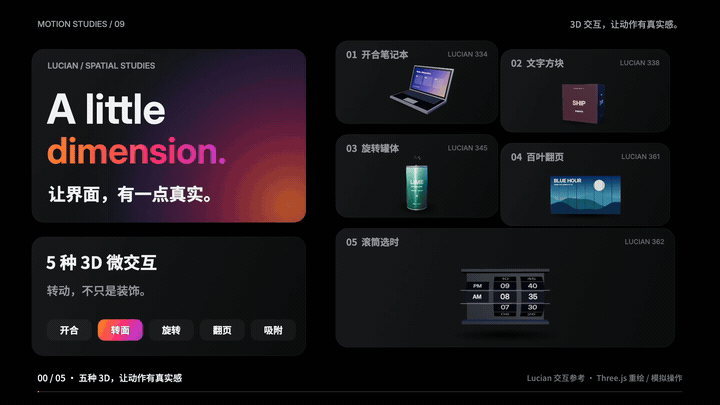

# 3D-interaction1 · 让界面，有一点真实

vibe 知识大赏｜五种 3D 微交互：**开合笔记本、文字方块、旋转罐体、百叶翻页、滚筒选时**。

20 秒讲清 **适用场景 + 可复用 AI 提示词 + 操作演示**，结尾总结 **场景 + 动作 + 反馈**。

**[在线交互演示与视频](https://jdb156158.github.io/3D-interaction1/)** · [下载 MP4](media/spatial-microinteractions-20s.mp4) · [下载影片源码 ZIP](media/spatial-microinteractions-source.zip)

## 视频效果

点击动图观看完整视频。20 秒 / 1920×1080 / 60fps / 原创合成音乐与音效。

[](https://jdb156158.github.io/3D-interaction1/#film)

## 亲手操作

|控件|适用场景|演示网页操作|
|---|---|---|
|开合笔记本|设备展示|拖动上盖、按上下键或调整角度；打开亮屏，合上熄屏。|
|文字方块|品牌文案|点击、滑动或按左右键，在 MAKE / MOVE / SHIP 间翻面。|
|旋转罐体|商品预览|横向拖动旋转，松手缓停；点击开罐，拉环抬起并出现气泡。|
|百叶翻页|作品轮播|点击或滑动，八片百叶错峰翻转，切换余晖与蓝调时刻。|
|滚筒选时|预约选时|拖动时段、小时和分钟，松手吸附；原生选框同步更新。|

沿用影片同款 Three.js 模型、材质、文字和风景纹理。支持桌面、触屏、键盘与减少动态偏好。演示为本地视觉交互，无业务提交。

## 可复用 AI 提示词


### 01 / 开合笔记本
为设备展示页制作可拖动的 3D 笔记本。用真正的铰链父节点旋转屏幕，限制开合角度。向上拖动或点击打开；打开到阈值后，屏幕依次点亮并显示演示桌面。合上时熄屏。拖动位置、角度与亮屏状态一致，提供键盘操作与减少动态替代。

### 02 / 文字方块
为品牌关键词轮播制作 3D 文字方块。每一面显示一个关键词，点击下一面时沿水平轴旋转 90 度；当前面明亮，侧面随角度变暗。底部指示器同步更新，翻到背面后文字仍保持正确阅读方向。支持前后切换、键盘和暂停自动播放。

### 03 / 旋转罐体
为商品预览制作可旋转的 3D 饮料罐。标签真实包裹圆柱，随透视自然缩窄；横向拖动改变朝向，松手后平滑减速。提供开罐按钮，拉环抬起并出现短暂气泡反馈。商品文字为明确标识的示例内容，支持触屏与键盘旋转。

### 04 / 百叶翻页
为作品轮播制作八片纵向百叶的 3D 翻页。每片正面显示当前图的一条，背面显示下一图对应的一条；点击下一张时按顺序错峰旋转，拼成完整新图，边缘有厚度和阴影。前后切换方向应一致，防止快速点击造成状态错乱，并提供减少动态切换。

### 05 / 滚筒选时
为预约或闹钟界面制作 3D 滚筒时间选择器。时段、小时、分钟按圆柱曲面排列，中线显示当前值，上下数字随曲面倾斜并变暗。拖动时跟手，松开后吸附最近刻度；选中值和顶部时间同步。支持键盘增减、触屏和明确的选中语义。

## 整片制作提示词

```text
制作 20 秒、1920×1080、60fps 的 3D 控件知识短片。
五项为开合笔记本、文字方块、旋转饮料罐、百叶翻页、滚筒选时。
每项显示使用场景、两行可复用 AI 提示词、明确的指针动作和操作结果。
延续黑色 Bento 分区、Inter 大标题、中文短句和橙粉紫标题渐变。
五项在片头和片尾同时编号展示，讲到的主体放大，其他收为缩略卡。
用 Three.js 真实几何表现铰链、立方体、柱面标签、双面百叶和数字滚筒。
模型用工作室灯光、接触阴影和克制的金属/哑光材质，保证转到背面后文字不倒置。
以 Canvas 合成字幕，暴露 window.draw(t)；画面完全由 t 决定，字体加载后创建文字纹理。
分镜：0–2 总览、2–5 笔记本、5–8 方块、8–11 罐体、11–14 百叶、14–17 滚筒、17–20 总结。
结尾总结「场景 + 动作 + 反馈」，落句「让复杂操作，变得凭直觉」。
Python 合成 120 BPM、2/4 拍配乐；章节在小节线上；交互音与动作落点对齐，完整乐句淡出。
先检查九帧并至少修改两轮，再逐帧导出 JPG，FFmpeg 编码 H.264 yuv420p + AAC、faststart。
检查实际 MP4 播放、拖动和音频峰值，交付视频、总览、源码、提示词和步骤。
```

## 制作步骤

1. 核对 Lucian 334 / 338 / 345 / 361 / 362 的交互机制，确定使用场景和可复用提示词，编写 20 秒分镜。
2. 用 Three.js 程序建模铰链、文字方块、柱面标签、双面百叶和数字滚筒，Canvas 合成 Bento 布局与字幕。
3. 暴露确定性 `draw(t)`，等待本地字体加载；检查九个关键帧并修改两轮。
4. Python 合成 120 BPM、2/4 拍配乐与动作音效，20 小节完整乐句，结尾淡出。
5. Playwright 导出 1,200 帧 JPG，FFmpeg 编码 H.264 Main / yuv420p + AAC，启用 faststart。
6. 抽查实际 MP4 画面，验证完整播放、跳转和音频峰值。
7. 在相同模型上接入真实拖动、按钮、键盘与选择框，检查 320/390px 窄屏和减少动态模式。
8. 上传视频、源码、提示词、制作步骤与静态网页到本仓库，GitHub Pages 从 main 根目录发布。

详细复现：[制作说明](docs/MAKING.md) · [提示词](docs/PROMPTS.md) · [分镜](film/treatment.md) · [影片验收](film/QA.md)。

## 本地运行

```sh
python3 -m http.server 4856
```

打开 `http://localhost:4856/`。无需构建。影片复现进入 `film/`：安装 Node.js、Python/numpy、Chrome 和 FFmpeg，再运行 `npm install`、`python3 make_audio.py`、`npm run render`、`sh encode.sh`。

## 目录

- `index.html` / `site/`：可交互演示网页。
- `film/`：确定性影片源码、音频合成、渲染脚本和分镜。
- `media/`：MP4、GIF 预览、总览图、影片源码 ZIP。
- `docs/`：完整提示词、制作步骤与网页验收记录。

## 来源与许可


- [Lucian 334 · 开合笔记本](https://lucianlabs.dev/uxui-prompt/#334)
- [Lucian 338 · 文字方块](https://lucianlabs.dev/uxui-prompt/#338)
- [Lucian 345 · 旋转饮料罐](https://lucianlabs.dev/uxui-prompt/#345)
- [Lucian 361 · 百叶翻页](https://lucianlabs.dev/uxui-prompt/#361)
- [Lucian 362 · 滚筒选时](https://lucianlabs.dev/uxui-prompt/#362)
- [观默 Bento Grid 视觉参考](https://guanmo-ai.github.io/design-style/?lang=zh#work-01-bento-grid)

模型、包装、屏幕、风景纹理、文字与配乐独立编写，均为教学示例。没有将参考站截图或影片剪入本片。Three.js 0.160.1 固定本地版本，MIT 许可见 vendor/THREE-LICENSE.txt；字体与其他库许可也随源码保留。
